# Drift_2.0 Screensaver for macOS

A fluid simulation screensaver for macOS, this repo helps install Drift as a native macOS bundle with a one-command installer.

This also fixes the bug on newer macOS versions where Drift only displays on the primary monitor when using multiple displays. Lines and flow are sized from each display's physical size, so they look the same on mixed monitors, including rotated (portrait) ones.

Built on [Flux](https://github.com/sandydoo/flux) by [Sander Melnikov](https://github.com/sandydoo)

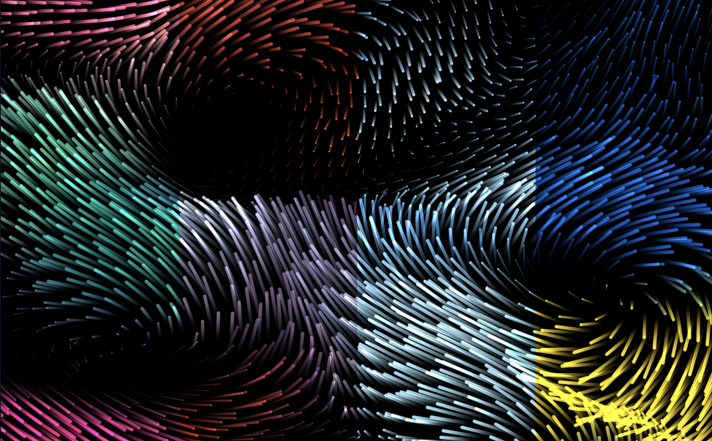

## Install

Requires macOS. The installer will prompt you if Xcode Command Line Tools are needed.

1. Open the **Terminal** app (search "Terminal" in Spotlight)
2. Copy the commands for your situation, paste them into Terminal, then press Enter:

<table>
<tr>
<th width="50%">New users<br><sub>Installing Drift_V2 for the first time</sub></th>
<th width="50%">Existing users<br><sub>Installed it before: removes the old version, then updates</sub></th>
</tr>
<tr>
<td valign="top">

```sh
cd ~ && git clone \
  https://github.com/yanzhehw/Drift_V2 &&
  cd Drift_V2 && ./install.sh
```

</td>
<td valign="top">

```sh
killall legacyScreenSaver 2>/dev/null
killall WallpaperAgent 2>/dev/null
rm -rf ~/Drift_V2 \
  ~/Library/Screen\ Savers/Drift_V2.saver
cd ~ && git clone \
  https://github.com/yanzhehw/Drift_V2 &&
  cd Drift_V2 && ./install.sh
```

</td>
</tr>
</table>

If you see `destination path 'Drift_V2' already exists`, you've installed before: use the **Existing users** commands.

3. Open **System Settings > Screen Saver** and select **Drift_V2**

### Updating from an earlier version

Earlier versions of Drift_V2 kept running in the background after the screen saver ended. On macOS 14 and later, the system process that hosts screen savers (`legacyScreenSaver`) stays alive afterwards and keeps every copy of the screen saver it has started. Those copies piled up and kept using CPU, GPU and memory while you were using your Mac. The current version shuts itself down when the screen saver ends, pauses whenever it isn't visible, and does less work per frame.

If you installed Drift_V2 before, use the update commands. They:

1. Stop leftover screen saver processes, which frees their resources right away. `WallpaperAgent` restarts on its own; your desktop picture isn't affected.
2. Delete the old screen saver and the `Drift_V2` folder downloaded by your first install.
3. Download and install the current version, the same way as a fresh install.

Your color scheme choice is kept. Afterwards, check that **Drift_V2** is still selected in **System Settings > Screen Saver**.

### What the installer does

1. Installs Rust temporarily if it isn't already present
2. Builds the screensaver from source (~2 min)
3. Installs it to `~/Library/Screen Savers/`
4. Cleans up all build artifacts, and removes Rust if it wasn't installed before

The final installed bundle is ~5 MB.

## Color Schemes

Open **System Settings > Screen Saver**, select **Drift_V2**, then click **Options** to choose:

<!-- Previews are rendered by drift/examples/previews.rs:
     cargo run -p drift-v2-screensaver --example previews --release -->
<table>
<tr>
<td align="center" valign="top" width="33%">
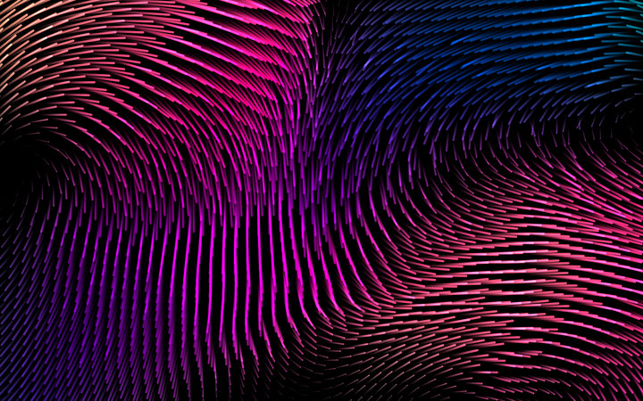<br>
<b>Original</b><br><sub>Classic Drift-style procedural colors</sub>
</td>
<td align="center" valign="top" width="33%">
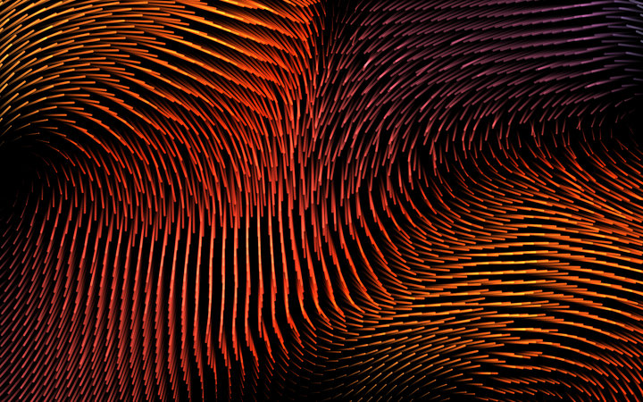<br>
<b>Plasma</b><br><sub>Warm purples and oranges</sub>
</td>
<td align="center" valign="top" width="33%">
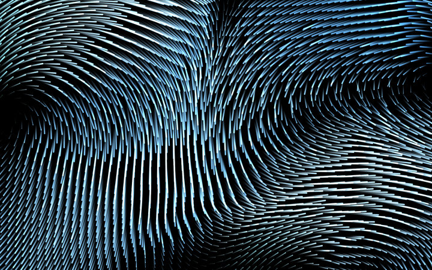<br>
<b>Poolside</b><br><sub>Cool aquatic blues</sub>
</td>
</tr>
<tr>
<td align="center" valign="top" width="33%">
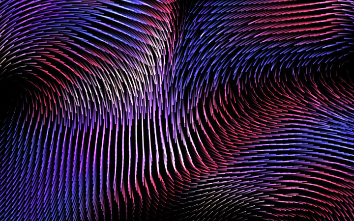<br>
<b>Gumdrop</b><br><sub>Candy-colored pastels</sub>
</td>
<td align="center" valign="top" width="33%">
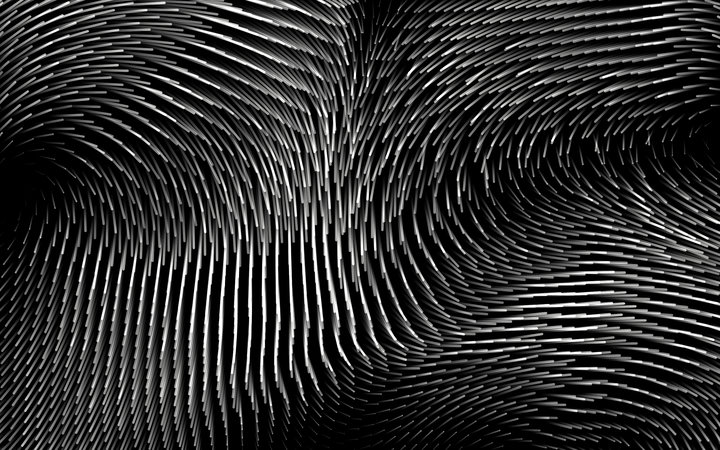<br>
<b>Silver</b><br><sub>Monochrome metallic</sub>
</td>
<td align="center" valign="top" width="33%">
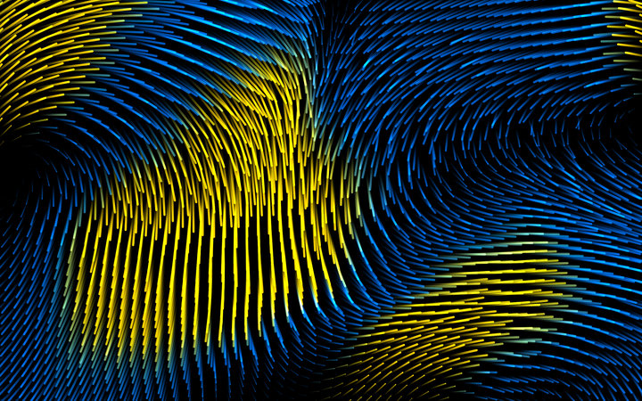<br>
<b>Freedom</b><br><sub>Blue and yellow</sub>
</td>
</tr>
<tr>
<td align="center" valign="top" width="33%">
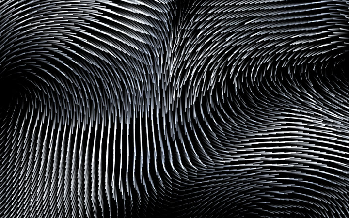<br>
<b>Space Gray</b><br><sub>Cool metallic grays</sub>
</td>
<td align="center" valign="top" width="33%">
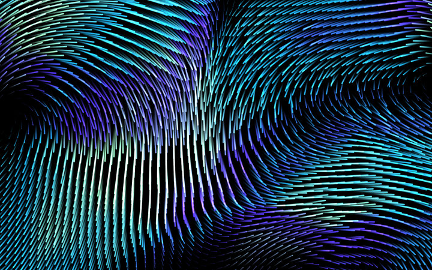<br>
<b>Aurora</b><br><sub>Violet, sky blue, and mint</sub>
</td>
<td align="center" valign="top" width="33%">
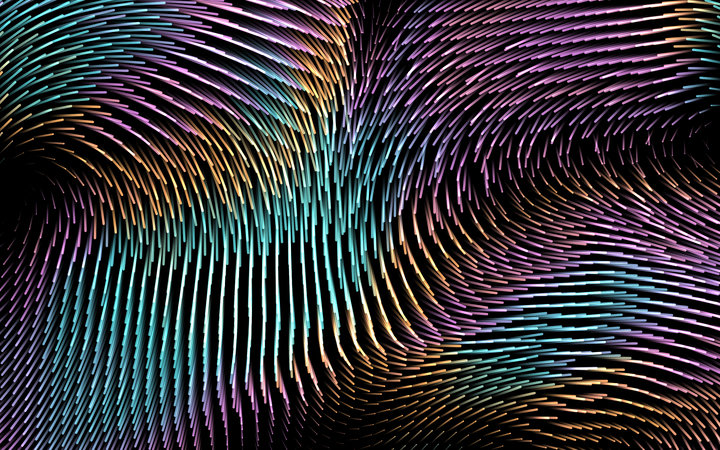<br>
<b>Atlas</b><br><sub>Peach, orchid, and teal</sub>
</td>
</tr>
<tr>
<td align="center" valign="top" width="33%">
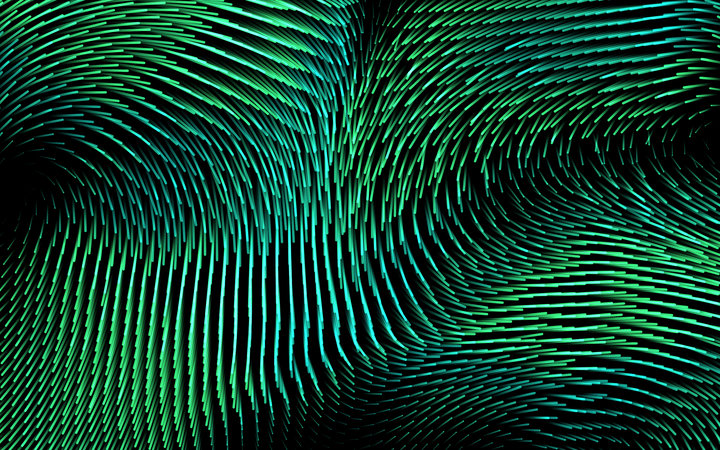<br>
<b>Emerald</b><br><sub>Deep teal to bright green</sub>
</td>
<td align="center" valign="top" width="33%">
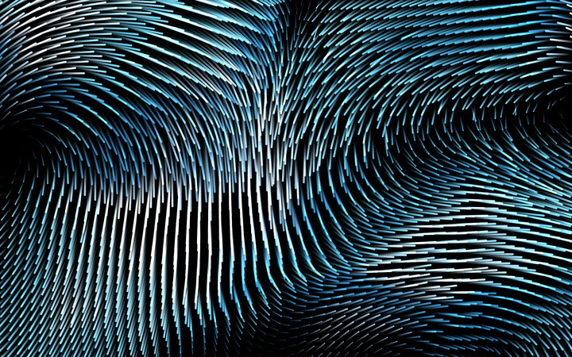<br>
<b>Glacier</b><br><sub>Icy blues and white</sub>
</td>
<td align="center" valign="top" width="33%">
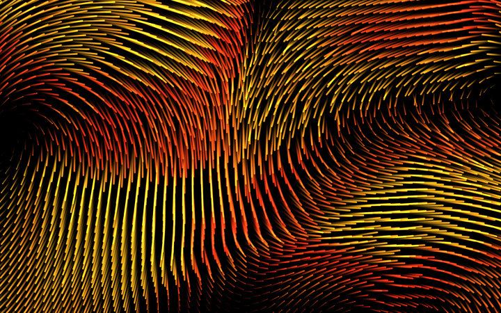<br>
<b>Ember</b><br><sub>Fiery red and amber</sub>
</td>
</tr>
</table>

## Frame Rate

**Options** also has a **Frame Rate** setting:

| Setting | Behavior |
|---------|----------|
| Auto (default) | 60 fps, dropping to 30 fps in Low Power Mode or when the Mac is running hot |
| 60 fps | Always 60 fps |
| 30 fps (lighter) | Always 30 fps, using roughly 40% less CPU |

Drift_V2 only renders while it's on screen. It pauses when covered, while the displays sleep, or when you switch users, and it shuts down completely once the screen saver ends.

## Uninstall

This stops the screen saver if it's still running, then deletes it and the downloaded `Drift_V2` folder:

```sh
killall legacyScreenSaver 2>/dev/null
rm -rf ~/Library/Screen\ Savers/Drift_V2.saver ~/Drift_V2
```

Then pick a different screen saver in **System Settings > Screen Saver**.

## Credits

The Flux engine is created by [Sander Melnikov (sandydoo)](https://github.com/sandydoo/flux) and released under the MIT license. This repo adds the macOS screensaver wrapper and installer.


## License

[MIT](LICENSE)
